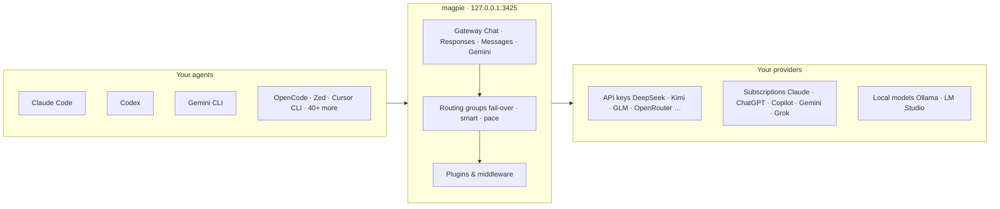

# magpie

### Every agent's model. One place.

**Claude Code on Kimi. Codex on DeepSeek. Gemini CLI on GLM. OpenCode on your ChatGPT plan.** 
Switch any of them from the menu bar. One local gateway serves them all, 
and when a quota runs out, it quietly moves on to the next account.

[](https://github.com/yetone/magpie-releases/releases/latest) [](https://github.com/yetone/magpie/stargazers) [](https://discord.gg/vGSnD3ZKQF) [](LICENSE) 

**[Download](https://usemagpie.ai)** &nbsp;·&nbsp; **[Docs](https://usemagpie.ai/docs/start)** &nbsp;·&nbsp; **[Reference](docs/reference.md)** &nbsp;·&nbsp; **[Plugins](https://github.com/magpie-community/plugins)** &nbsp;·&nbsp; **[Discord](https://discord.gg/vGSnD3ZKQF)** &nbsp;·&nbsp; **English** · [简体中文](README.zh-CN.md)

## Is magpie for you?

Each agent keeps its model in its own file, in its own format, with its own keys and base URLs. A subscription you pay for works in one agent and nowhere else. magpie puts all of that behind one app and one local gateway:

- **Pick any model for any agent** from one list. magpie edits the one key that matters in the agent's own config.
- **Use one provider everywhere**: an API key, a local model, or the Claude, ChatGPT, Copilot, Gemini or Grok plan you're signed in to.
- **Keep going when a quota runs out**: a routing group moves to the next account or model, and the agent never sees the error.

It's for you if you use more than one agent, more than one provider, or more than one account. If you use one agent on its vendor's own plan and that's enough, you don't need it.

Runs on macOS, Windows and Linux (menu bar app, window, TUI, web UI and CLI), in Docker, and on Termux.

## Quick start

**1 · Install.** Download the app from **[usemagpie.ai](https://usemagpie.ai)**, or run:

```sh
curl -fsSL https://usemagpie.ai/install.sh | sh
```

 Mac builds are signed and notarised, and every build updates itself. Behind a firewall, use `--proxy` or `--mirror`. Or `go install github.com/yetone/magpie@latest`, or the [Docker image](https://usemagpie.ai/docs/docker). 

**2 · Add a provider.** Open magpie and go to **Providers → Add provider**. Pick a preset and paste a key, or sign in with a subscription.

**3 · Pick a model** for each agent on the **Agents** page. Start a new session and it's on the new model.

Or do it all from the terminal:

```sh
magpie provider add deepseek sk-… # a preset needs only the key
magpie claude deepseek/deepseek-v4-pro # Claude Code on DeepSeek
magpie codex moonshot/kimi-k2.5 # Codex on Kimi
magpie group add "Opus anywhere" models=claude/claude-opus-5-5,copilot/claude-opus-5.5 routing=smart
magpie claude group/opus-anywhere # fails over between subscriptions
magpie save work && magpie use work # profiles
magpie quota # what's left on every plan
magpie tui # the whole thing, in a terminal
```

magpie finds the subscriptions your agents are signed in to by reading their sign-ins (Claude Code's and Codex's files, the Keychain). To keep it from reading them, turn off Settings → Privacy → *Subscription accounts*, or run `magpie accounts discovery off` (`on` turns it back on). `MAGPIE_NO_ACCOUNTS=1` turns it off for one run without changing the saved setting. API-key providers work either way.

## Supported agents

Claude Code · Claude Desktop · Codex · Gemini CLI · Antigravity CLI · OpenCode · OpenChamber · MiMo Code · Pi · oh-my-pi · Aside · OmO · Prime Agent · Goose · Cursor CLI · Cursor Private Inference · Zed · VS Code Chat · VS Code Insiders · VSCodium Chat · JetBrains Air · Copilot (JetBrains) · Copilot CLI · Crush · DeepSeek Harness · Reasonix Studio · Command Code · fx · Devin · Hermes Agent · Mister Morph · Kimi Code · jcode · Qwen Code · Muse Code · Empryo · MiniMax Code · Droid · Cline · Qoder · Qoder CN · Grok Build · Grok App · ZCode · WorkBuddy · WorkBuddy AI · CodeBuddy Code · Pencil · T3 Code · OpenHanako · AtomCode · Snow CLI · Alma · Cindy

magpie shows only the agents installed on your machine; setup notes for some of them are in the [reference](docs/reference.md#notes-on-some-agents). Anything else that takes a base URL can use the gateway too:

```sh
export OPENAI_BASE_URL=http://127.0.0.1:3425/v1 OPENAI_API_KEY=magpie
export ANTHROPIC_BASE_URL=http://127.0.0.1:3425 ANTHROPIC_API_KEY=magpie
export GOOGLE_GEMINI_BASE_URL=http://127.0.0.1:3425 GEMINI_API_KEY=magpie
```

## How it fits together

The gateway at `127.0.0.1:3425` speaks OpenAI Chat, OpenAI Responses, Anthropic Messages and Gemini, and translates between them, streaming, tool calls and reasoning included.



## What it does

### Any model, any agent

Click a value and a searchable list opens: every model of every provider you added, as `provider/model`. The agent's config is rewritten atomically, and its comments, order and formatting stay as they were. **Profiles** save every agent's setup under one name ("Budget", "Focus") and switch them all back in one move. Each agent can also have its own short list of models; a profile keeps that list too.

### Providers

Pick a preset, paste a key. Model lists come from the vendor, with names and reasoning levels filled in from [models.dev](https://models.dev), so a model released this morning is in your picker on the next refresh.

> **Presets include** Anthropic · OpenAI · Google Gemini · Google Vertex AI · DeepSeek · Kimi · Zhipu GLM · MiniMax · StepFun · Qwen · Baidu Qianfan · Tencent Cloud 